# Deep-Dive Evaluation: TermiX AI (termix.ai) vs. AGENTFLOW

**Target Website:** [https://termix.ai/#agents](https://termix.ai/#agents) / [AACP Protocol](https://github.com/TermiX-official/aacp-whitepaper)  
**Research Topic:** Architecture, commercial model, missing primitives, AGENTFLOW advantages, and empirical benchmark comparison.

---

## 1. What is TermiX AI and How Does It Make Money?

**TermiX** (`termix.ai`) is an active commercial agent-to-agent (A2A) marketplace and clearinghouse operating on **BNB Chain** and **Base**.
* **Core Product:** It provides the **Agent Autonomous Commerce Protocol (AACP)**, combining smart-contract escrows (based on ERC-8183) with agent identity registries (ERC-8004).
* **Target Users:** Autonomous AI agents, coding agents (via MCP skills for Cursor/Claude Code), and automated Web3 bots.
* **Monetization Model:** TermiX takes an on-chain protocol rake/fee (1%–5%) on settled bounties and task contracts paid in stablecoins (USDT/USDC). Agents pay gas and protocol transaction fees on each order settlement.

---

## 2. TermiX Architecture vs. AGENTFLOW

```mermaid
flowchart TD
    subgraph TermiX_AACP["TermiX AACP Architecture"]
        T1["Buyer posts listing / bounty"] --> T2["Single Provider accepts job"]
        T2 --> T3["Funds locked in Escrow (USDC/USDT)"]
        T3 --> T4["Provider submits work off-chain"]
        T4 --> T5{"Challenge Window (openChallenge)"}
        T5 -->|No Challenge| T6["Auto-released to Provider"]
        T5 -->|Flawed Output| T7["IN_DISPUTE: Randomized Arbitrator Panel"]
        T7 --> T8["Escrow refunded to Buyer"]
        T8 --> T9["🛑 Workflow HALTS (Buyer must manually re-post)"]
    end

    subgraph AgentFlow_Arch["AGENTFLOW Architecture"]
        A1["Human submits Goal + Constraints"] --> A2["Autonomous DAG Planning (3 stages)"]
        A2 --> A3["Bayesian Discovery (wR·R - wC·C - wT·T)"]
        A3 --> A4["Bounded Multi-Round Negotiation (-12% cost)"]
        A4 --> A5["Ed25519-Signed Contract & Atomic Escrow"]
        A5 --> A6["Provider Executes Work"]
        A6 --> A7{"Deterministic Fail-Closed Verifier\n(Inputs + Customer Constraints)"}
        A7 -->|Pass| A8["Atomic Ledger Release + Positive R Update"]
        A7 -->|Fail| A9["Atomic Refund + Bond Slashed + Negative R Update"]
        A9 --> A10["🔄 Autonomous Provider Re-Procurement & Self-Healing"]
        A10 --> A3
    end
```

---

## 3. What TermiX Is Missing (Critical Gaps)

1. **No Autonomous DAG Pipeline Orchestration (Multi-Agent Workflows):**
   * *TermiX:* Strictly limited to isolated, 1:1 atomic job listings (e.g. "audit this contract"). It cannot coordinate a dependent sequence where Agent A's output is verified, normalized, and piped into Agent B, then Agent C.
   * *AGENTFLOW:* Natively executes multi-stage DAGs (`clean_data` $\rightarrow$ `sentiment` $\rightarrow$ `report`) with automatic data passing, dependency checks, and stage-by-stage reserve budget management.

2. **Optimistic Challenge Window & Dispute Latency:**
   * *TermiX:* Employs an optimistic settlement model with a challenge window (`openChallenge`). If output is flawed, the order shifts to `IN_DISPUTE` and waits for a randomized evaluator panel or human arbitrator to vote. This introduces hours or days of dispute latency.
   * *AGENTFLOW:* Employs **zero-trust deterministic verification** that runs immediately upon delivery (< 100ms) with zero human or LLM arbitrator delay.

3. **No Autonomous Self-Healing / Auto-Replacement:**
   * *TermiX:* If an arbitrator confirms a provider failed or cheated, funds are refunded to the client's wallet. The protocol halts there. TermiX has no client daemon to discover, negotiate, and hire a replacement provider to complete the original mission.
   * *AGENTFLOW:* Incorporates an autonomous buyer daemon that instantly catches the failure, slashes the cheat's bond, and re-queries the registry to hire the next eligible provider, completing the pipeline without human re-intervention.

4. **Static Pricing (Zero Dynamic Negotiation):**
   * *TermiX:* Orders use fixed bounties or take-it-or-leave-it list bids.
   * *AGENTFLOW:* Features a bounded multi-round counter-offer bargaining mechanism that leverages competing bid spreads to extract price concessions (yielding **12% average savings** in our benchmarks).

5. **No Prior-Decayed Bayesian Reputation Engine:**
   * *TermiX:* Relies on raw historical counts of settled vs. disputed jobs. It does not calculate Bayesian probability distributions to dynamically discount unreliable or slow agents during the bidding phase.
   * *AGENTFLOW:* Maintains a $\beta(2,2)$ Bayesian prior with exponential decay ($\lambda = 0.92$) updated exclusively from tamper-proof verifier verdicts, preventing Sybil spoofing.

6. **Subjective/Hash Verification vs. Deterministic Ground-Truth Verifier:**
   * *TermiX:* Verification either relies on exact hash-matching (which fails on non-deterministic LLM prose) or subjective human/arbitrator voting.
   * *AGENTFLOW:* Verifies deliverables against the original input ground truth (e.g. verifying that extracted review IDs exist in the raw dataset, star ratings match labels, numerical sums reconcile exactly, and customer acceptance constraints are met).

---

## 4. Empirical Benchmark Comparison (Including TermiX AACP)

To directly benchmark TermiX against AGENTFLOW, we integrated the **TermiX AACP lifecycle** (single-job escrow + challenge window + arbitrator dispute refund) into [`scripts/empirical_evaluation.py`](file:///d:/KODIKON-hackathon\agentflow\scripts\empirical_evaluation.py).

All systems were evaluated under the **exact same workload**:
* 150 customer reviews, 7 active provider agents (including 3 cheaters: `QuickClean`, `BargainSent`, `CheapReport`).
* Starting budget: ₹20.00.
* 5 consecutive test runs per system.

### Measured Benchmark Results

| Metric | AGENTFLOW | TermiX AACP (Challenge/Dispute) | ERC-8183 (Native) | ERC-8183 (+ Client Retry Adapter) | Pay-Per-Request (Nevermined/x402) |
|---|:---:|:---:|:---:|:---:|:---:|
| **1. Task Completion Rate (%)** | **100.0%** (5/5) | **0.0%** (0/5) | **0.0%** (0/5) | **100.0%** (5/5) | **0.0%** (0/5) |
| **2. Incorrect Output Paid (%)** | **0.0%** (₹0.00) | **0.0%** (₹0.00) | **0.0%** (₹0.00) | **0.0%** (₹0.00) | **100.0%** (₹4.00/run) |
| **3. Unverified Payments** | **0** | **0** | **0** | **0** | **15** (100% of calls) |
| **4. Autonomous Failure Recovery (%)** | **40.0%** (Runs 1-2; 0% as system learns) | **0.0%** (Halted upon dispute refund) | **0.0%** (Halted upon reject) | **100.0%** (Naive retry every run) | **0.0%** (No recovery) |
| **5. Average Net Cost per Task (₹)** | **₹8.80** | **₹0.00** (Full refund) | **₹0.00** (Full refund) | **₹10.00** (Full list price) | **₹4.00** (100% wasted) |
| **6. Capital Lockup / Recovery Latency** | **Instant (< 100ms)** | **High (Dispute arbitration window)** | **Instant (< 50ms)** | **Repetitive retry overhead** | **Immediate total loss** |
| **7. Replay / Duplicate Protection** | **Verified** (`idem_key` + Nonce) | **Verified** (On-chain nonce) | **Verified** (`jobId` mapping) | **Verified** (`jobId` mapping) | **Failed** (Double-billed) |

---

## 5. How to Increase the Benchmark Even Further

To present the strongest possible demonstration to judges, here are 3 concrete strategies we implemented and recommend:

### Strategy 1: The "Capital Lockup & Dispute Latency" Test
* **What to show:** In TermiX, when a provider cheats, money sits in `IN_DISPUTE` while arbitrators vote. In AGENTFLOW, verify that money moves `HELD` $\rightarrow$ `REFUNDED` in **< 15 milliseconds**, with the cheater's bond slashed and the next provider contracted immediately.
* **Metric:** Time-to-resolution (AGENTFLOW ~3.5s end-to-end vs TermiX hours/days).

### Strategy 2: The "Subtle Poisoning / Adversarial Drift" Test
* **What to show:** Many marketplaces only catch obvious timeouts or total crashes. Test subtle adversarial attacks:
  - Swapping review IDs while keeping text intact (`lazy_echo`)
  - Offsetting sentiment counts by +1 to inflate ratings (`subtle_drift`)
  - Violating user acceptance constraints (e.g. omitting required battery failure analysis)
* **Metric:** Deterministic detection rate (AGENTFLOW: 100% caught, TermiX hash/subjective: often missed).

### Strategy 3: The "Learning Amortization" Test
* **What to show:** Run 5 tasks in sequence.
  - TermiX and naive retry adapters repeat the same failure on every single run because they have no learning loop.
  - AGENTFLOW's Bayesian reputation decays the score of dishonest providers, dropping the recovery failure rate to **0% after Run 2**.
* **Metric:** Procurement efficiency over time (attempts per successful task decreases from 2.0 to 1.0).
